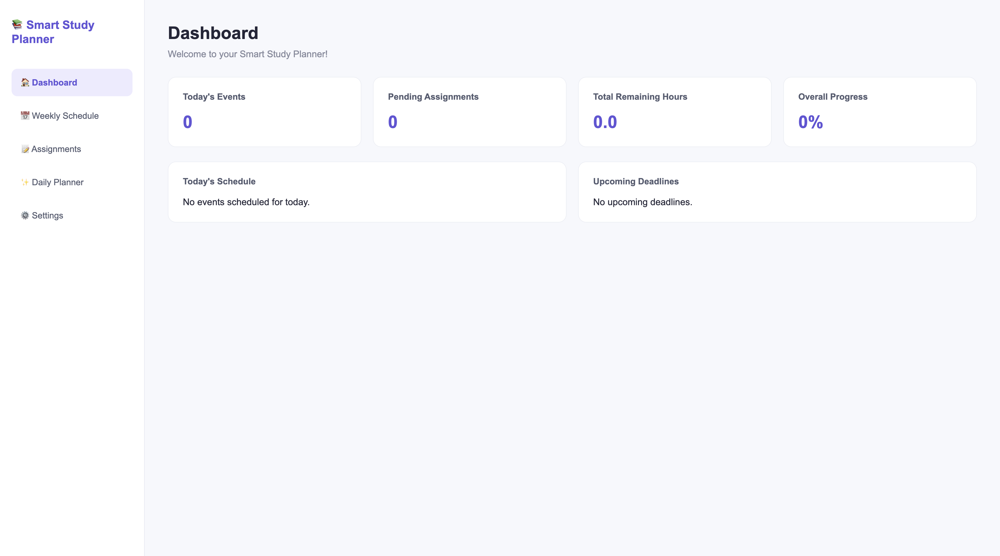
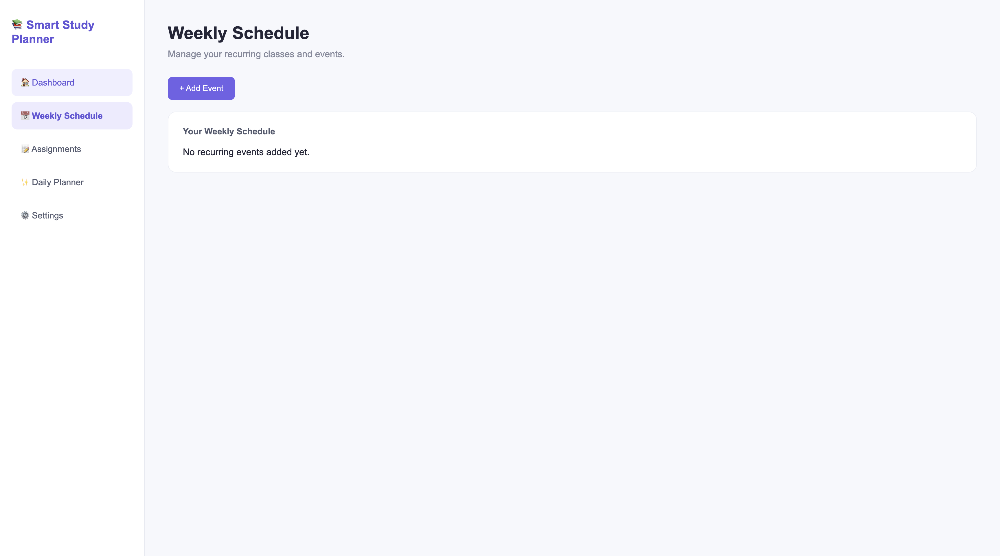

# Smart Study Planner

A web-based study planning application that helps students organize their schedules, manage assignments, and generate personalized daily study plans.

## Live Demo

Try Smart Study Planner here:

https://dayoungin-ucsd.github.io/dsc190-final-project/

## Project Overview

College students often struggle to balance classes, assignments, and study time.

Smart Study Planner helps students manage their academic responsibilities by combining weekly scheduling, assignment tracking, and automatic daily study planning in one application.

## Screenshots

### Dashboard

### Weekly Schedule

### Assignments

### Daily Planner

### Settings

## Features

### 1. Dashboard
- View today's scheduled events
- Track pending assignments
- Check total remaining study hours
- Monitor overall assignment progress
- View upcoming deadlines

### 2. Weekly Schedule
- Add recurring weekly events
- Specify event names, days, times, and categories
- Prevent overlapping events
- Delete existing events

### 3. Assignment Management
- Add assignments with course names and deadlines
- Estimate required study hours
- Update assignment progress
- Track remaining work
- View assignments sorted by deadline

### 4. Smart Daily Planner
- Set available study hours
- Automatically identify free time between scheduled events
- Prioritize incomplete assignments
- Generate study sessions based on available time
- Insert breaks between study sessions
- Display a daily study summary

### 5. Customizable Settings
- Adjust study session duration
- Adjust break duration
- Save preferences for future visits

## How the Smart Planner Works

The daily planner uses a rule-based scheduling algorithm:

1. Identify the user's available study time.
2. Exclude time occupied by recurring weekly events.
3. Calculate remaining work for incomplete assignments.
4. Prioritize assignments using remaining work and time until the deadline.
5. Allocate available time to study sessions.
6. Insert breaks according to the user's settings.

## Technologies Used

- HTML
- CSS
- JavaScript
- Browser Local Storage
- GitHub Pages

## How to Use

1. Open the application.
2. Add recurring events in Weekly Schedule.
3. Add assignments and estimated study hours.
4. Update assignment progress as work is completed.
5. Open Daily Planner.
6. Select available study hours.
7. Click the Generate Plan button.
8. Adjust study and break durations in Settings.

## Data Storage

The application uses browser local storage to save events, assignments, and user preferences.

Data is stored locally in the browser and does not require an account.

## Limitations

- Data does not automatically sync across devices or browsers.
- Study plans are generated based on estimated remaining work and deadlines.
- The application does not currently integrate with external calendars.

## Author

DSC190 Final Project  
University of California, San Diego