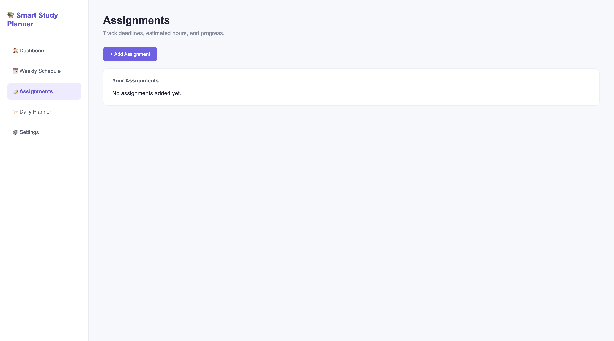
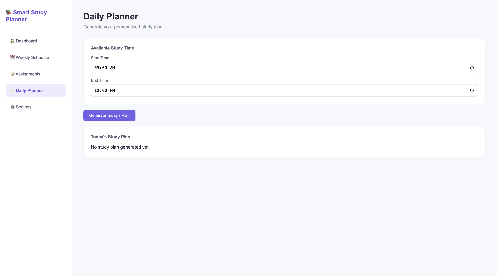
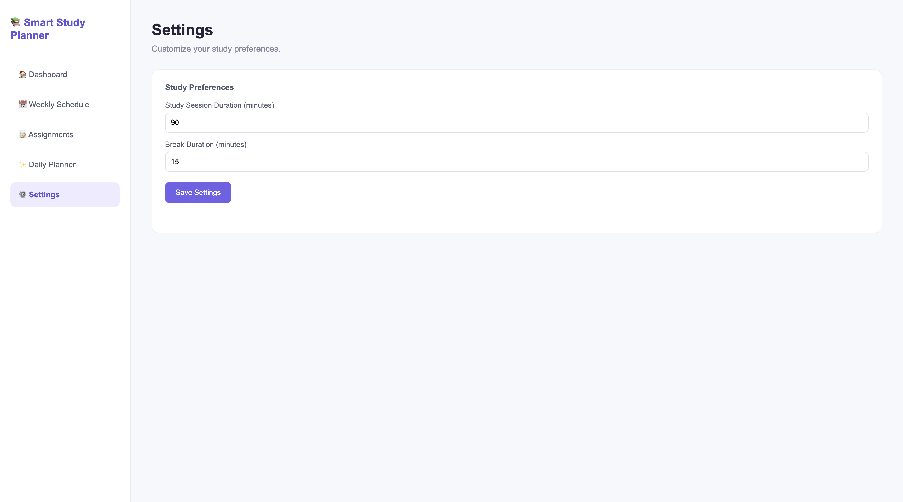

# Smart Study Planner

A web-based study planning application that helps students organize their schedules, manage assignments, and generate personalized daily study plans.

## Live Demo

Try Smart Study Planner here:

https://dayoungin-ucsd.github.io/dsc190-final-project/

## GitHub Repository

Source code:
https://github.com/dayoungin-ucsd/dsc190-final-project

## Project Overview

College students often struggle to balance classes, assignments, and study time.

Smart Study Planner helps students manage their academic responsibilities by combining weekly scheduling, assignment tracking, and automatic daily study planning in one application.

## Screenshots

### Dashboard

### Weekly Schedule

### Assignments

### Daily Planner

### Settings

## Features

### 1. Dashboard
- View today's scheduled events
- Track pending assignments
- Check total remaining study hours
- Monitor overall assignment progress
- View upcoming deadlines

### 2. Weekly Schedule
- Add, edit, and delete recurring weekly events
- Schedule events on multiple days of the week
- Organize events using customizable categories and colors
- Prevent overlapping events
- View events in a visual weekly timetable

### 3. Assignment Management
- Add assignments with course names and deadlines
- Estimate required study hours
- Update assignment progress
- Track remaining work
- View assignments sorted by deadline

### 4. Smart Daily Planner
- Select a study date and preferred study hours
- Customize available time using an interactive 10-minute grid
- Mark unavailable periods and add optional reasons
- Automatically exclude recurring weekly events
- Exclude specific weekly events for individual dates
- Prioritize incomplete assignments based on deadlines and remaining work
- Automatically generate study sessions and breaks
- View generated plans in a visual daily timetable
- Save and revisit study plans for different dates
- Add, edit, and delete individual study sessions
- Mark study sessions as completed
- Track daily study progress and completion
- Add notes to individual study sessions and daily plans

### 5. Customizable Settings
- Adjust study session duration
- Adjust break duration
- Save preferences for future visits

## How the Smart Planner Works

The daily planner uses a rule-based scheduling algorithm:

1. Identify the user's available study time.
2. Exclude time occupied by recurring weekly events.
3. Calculate remaining work for incomplete assignments.
4. Prioritize assignments using remaining work and time until the deadline.
5. Allocate available time to study sessions.
6. Insert breaks according to the user's settings.

## Technologies Used

- HTML
- CSS
- JavaScript
- Browser Local Storage
- GitHub Pages

## How to Use

1. Open the application.
2. Add recurring classes, work, or personal events in Weekly Schedule.
3. Add assignments with deadlines, estimated hours, and progress.
4. Open Daily Planner and select a study date.
5. Set your preferred study start and end times.
6. Click **Edit Available Time** to mark unavailable periods using the 10-minute grid.
7. Click **Save Changes** to save your availability settings.
8. Review the weekly events imported for the selected date.
9. Click **Generate & Save Plan** to create a personalized study schedule.
10. Open a saved plan to view its timetable, edit sessions, track completion, and add notes.
11. Adjust study session and break durations in Settings.

### Example: Planning a Study Day

Suppose a student has the following schedule and assignments:

**Weekly Schedule:**
- Lecture: Monday, 10:00 AM – 11:00 AM
- Lab: Monday, 2:00 PM – 3:00 PM

**Assignments:**
- Math Homework: Due in 2 days, 3 hours remaining
- Research Paper: Due in 5 days, 6 hours remaining
- Programming Project: Due in 7 days, 4 hours remaining

The student opens the Daily Planner and sets their available
study time from 9:00 AM to 6:00 PM.

The Smart Study Planner then:

1. Identifies available study periods between scheduled events.
2. Prioritizes assignments based on deadlines and remaining work.
3. Generates study sessions without overlapping lectures or labs.
4. Inserts breaks according to the user's settings.
5. Displays the total scheduled study time and number of sessions.

For example, with 60-minute study sessions and 10-minute breaks,
the planner may generate a schedule like:

- 9:00 AM – 10:00 AM: Math Homework
- 10:00 AM – 11:00 AM: Lecture (existing event)
- 11:00 AM – 12:00 PM: Research Paper
- 12:00 PM – 12:10 PM: Break
- 12:10 PM – 1:10 PM: Research Paper

The exact generated plan depends on the current day,
existing events, assignment priorities, and user settings.

## Data Storage

The application uses browser local storage to save:

- Weekly events and custom categories
- Assignments and progress
- Availability preferences for individual dates
- Generated daily study plans
- Study session completion status
- Session notes and daily notes
- Study and break duration settings

Data is stored locally in the browser and does not require an account.

## Limitations

- Data does not automatically sync across devices or browsers.
- Study plans are generated based on estimated remaining work and deadlines.
- The application does not currently integrate with external calendars.